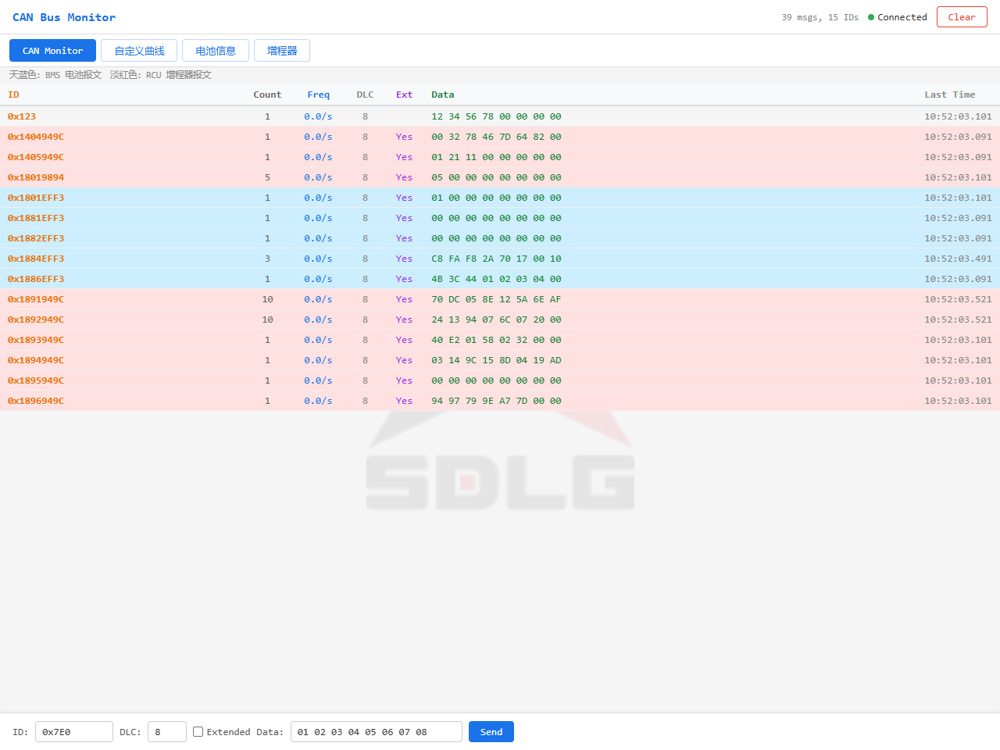

# 电池与 RCU 联合烧录与台架模拟验证（2026-10-21）

> **验证状态（2026-10-21，截至本次提交）：今天截至目前的所有提交均未经过真机验证。**
> 本报告中的“通过”仅指 PCAN/ESP32 台架模拟检查通过，不代表真实电池、增程器或车辆验证；见 [今日提交验证状态](validation-status.md)。

本轮将同时包含 CATL 电池页和玉柴 RCU 增程器页的新固件烧录到 ESP32-S3，
使用独立 PCAN-USB 台架同时广播两类数据，两个真实网页客户端分别打开电池页和增程器页。
这是协议模拟台架验证，未连接真实电池、增程器或车辆。

## 固件与配置

| 项目 | 结果 |
|---|---|
| 烧录接口 | COM5，ESP32-S3 USB-Serial/JTAG |
| 硬件 | 16MB Flash、8MB PSRAM |
| 构建 | ESP-IDF 5.4.4，`build-mail/` |
| 应用字节数 | 1,170,016 |
| 应用 SHA-256 | `76b677f88b24e25c31d7b810b9c95efebc9eecdc78864baedeefed492c259f8f` |
| 三段烧录 | bootloader、分区表、应用均通过 Hash 校验 |
| 配置 | 未擦除 NVS；4 组完整信号定义前后比较一致，邮件配置状态保留 |
| 内存 | PSRAM 可用，记录容量 349525 帧 |
| 当次网页 | `http://10.31.134.250`，取决于热点网段 |

## 同总线、双网页检查

PCAN 为 `PCAN_USBBUS1`，250 kbps，经典 CAN 扩展广播；另有普通标准帧作背景。
RCU 快报文按 20ms 目标周期调度，其余按原协议周期；Windows 调度为尽力发送，
完整性按**实际发送成功条数**核对，不用理论计划量充当设备接收量。

| 阶段 | 实际发送帧数 | 验证结果 |
|---|---:|---|
| 正常混合广播 | 714 | 电池 80%、600V、100A、温度28/35/20°C；RCU 充电、发动机1600rpm、FISG1500rpm、600V、−100A、−60kW；45项读数可用 |
| 双方故障 | 714 | 电池故障等级/代码/明细正确；RCU 两类等级、高压急停、五个分组稀疏故障正确 |
| 仅清故障第一组 | 341 | 电池恢复正常；RCU 第一组零位图清除自身，其余四组已报告故障仍保留 |
| 无效/短帧 | 536 | 电池无效值和温度传感器异常正确；RCU 越界模拟值、短DLC不显示为零或正常读数 |
| 零值与有效边界恢复 | 714 | 双方有效零值正确；RCU 24位电量最大值、12位功率2095、30位产品代号最大值和原始故障码255未被误判为无效 |
| **合计** | **3019** | **ESP32 接收增量3019，逐阶段未收到自动发送的数据帧；boot标识始终一致** |

五个故障组在设备端分别缓存，两个网页读到的 RCU 快照同时保留全部 13 个有效槽，
不因同 ID 的后续分组覆盖之前的分组。混合广播包含 BMS 有效 VIN 请求，设备未自动应答。
电池数据和 RCU 数据分别解码，页面切换不改变配置，不触发 `/api/send`。

主表同时验证九个 RCU ID 为淡红色、五个 BMS ID（含 VIN 请求）为天蓝色，
普通 `0x123` 标准帧保持原背景。



## 手动发送、停止与最终状态

- 显式点击一次原有 Send 按钮，发送标准帧 `0x123 [4] CA FE 12 34`，PCAN 独立收到且无额外帧。
  此帧是 ESP32 发出，TWAI 不自接收，不计入上述 3019 个接收帧。
- 停止广播后电池读数按 10 秒超时变为 `—`、故障待确认；RCU 普通报文10秒、版本报文15秒超时，
  所有状态都变为超时，旧零值不继续冒充实时读数。
- 两个网页无 JavaScript 错误；设备未重启。最终 TWAI RUNNING、TEC=0、REC=0，
  信号配置仍为4组，PSRAM记录容量不变，未启动记录或发送邮件。
- PCAN 发送已结束，适配器和串口句柄已关闭，ESP32继续运行。没有持续发送的测试进程。

证据：[联合测试报告](validation/battery-rcu-20261021/joint-pcan-report.json)、
[设备最终状态](validation/battery-rcu-20261021/final-status.json)。
完整烧录日志和阶段截图在本地 `tmp/rcu/hardware/`。

## 重复执行

需要 `python-can`、PCAN驱动、Playwright及浏览器。下列脚本会真实发送模拟报文，
仅用于独立 PCAN/ESP32 台架；会在接收验证后显式执行一次手动发送。

```powershell
$env:PLAYWRIGHT_MODULE = 'C:\Users\liche\.cache\codex-runtimes\codex-primary-runtime\dependencies\node\node_modules\playwright'
$env:BROWSER_EXECUTABLE = 'C:\Program Files (x86)\Microsoft\Edge\Application\msedge.exe'
$env:CAN_PYTHON = 'C:\Espressif\tools\python\python.exe'
node tools/test-battery-rcu-pcan.mjs http://10.31.134.250
```

脚本使用确定性协议载荷，发送时间有界，每个发送子进程在退出时释放 PCAN。
验证失败时保存已完成阶段及错误，当前阶段也等待有界发送结束再退出。
本轮结论不替代真实电池/增程器接入或长时间高负载压力验证。
