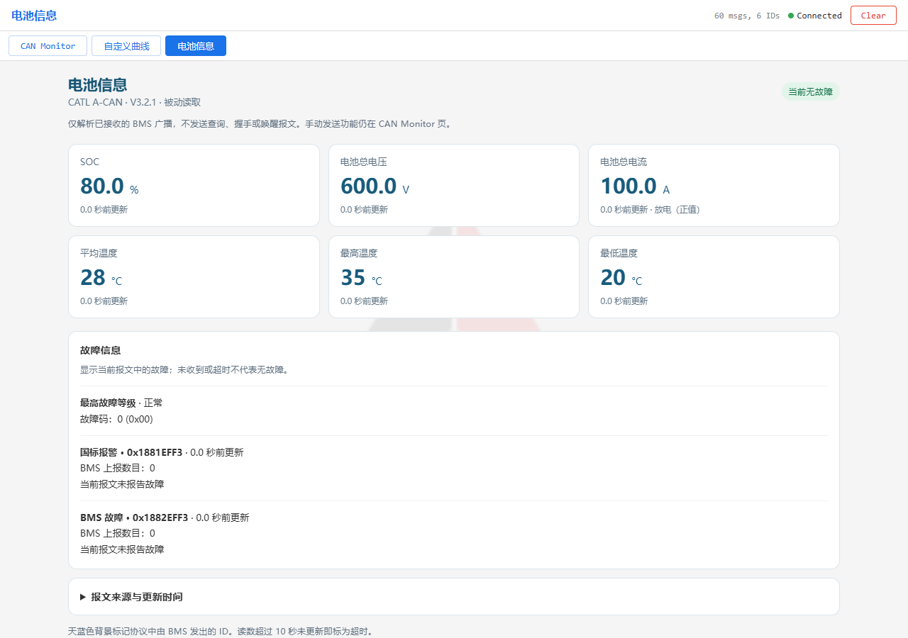
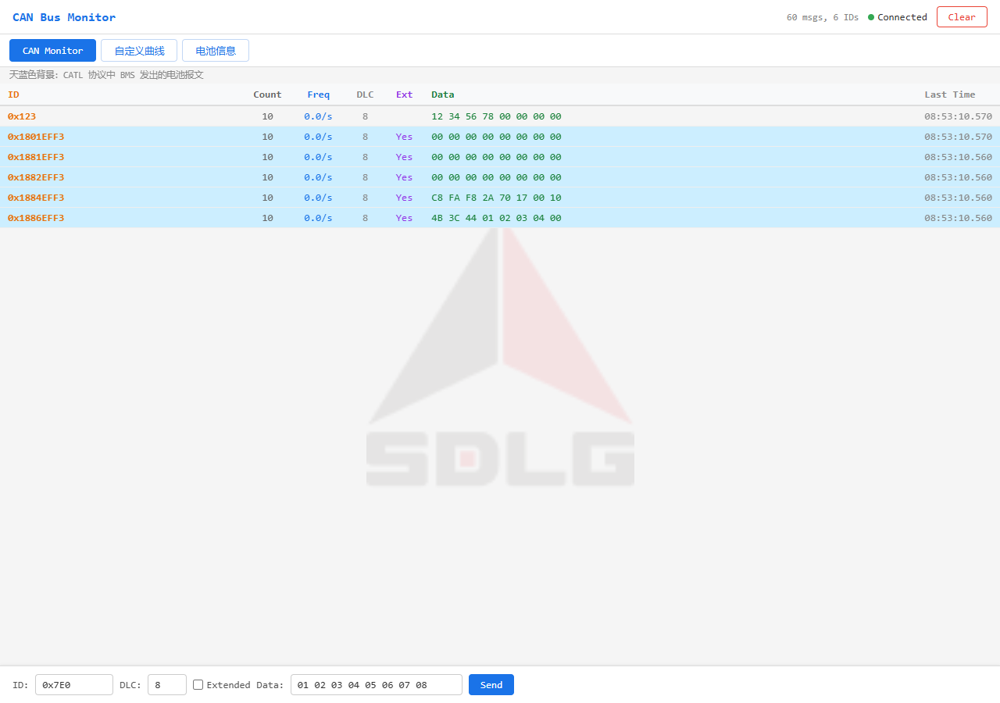

# CATL 电池信息页

依据用户提供的 `CATL_eBUS_Protocol_A-CAN_V3.2.1_20220613.pdf` 实现。
协议第 14–15 页规定 250 kbps、Intel 小端、`物理值 = 原始值 × Factor + Offset`。

## 被动读取与手动发送

电池页仅消费设备已经接收的扩展数据帧，不发送查询、握手、VIN 响应、唤醒或远程请求帧。
即使收到 BMS 的 `B2V_RQ` 请求，也只在监控表显示，不作 CAN 响应。
切换页面、读取状态和自动刷新均不会调用 `/api/send`。

原有 CAN Monitor 页的手动发送面板、`POST /api/send` 和 `can_send_message()` 保留，
TWAI 继续使用 NORMAL 模式。NORMAL 模式在 CAN 链路层按原有方式应答 ACK，
不是 LISTEN_ONLY 静默模式。浏览器向 ESP32 读取 HTTP 接口、授时、保存配置不会产生 CAN 查询。

## 显示字段

所有位号均从 Byte0 的最低位开始，跨字节数值按小端提取。

| 页面字段 | 扩展 CAN ID | 起始位 / 位长 | 换算 | 无效或异常 |
|---|---|---|---|---|
| SOC | `0x1884EFF3` | 0 / 8 | raw × 0.4 % | `0xFF` 无效；超出 0–100% 不显示为读数 |
| 总电流 | `0x1884EFF3` | 16 / 16 | raw × 0.1 − 1000 A | `0xFFFF` 无效；有效范围 −1000 至 1000 A |
| 总电压（包内侧） | `0x1884EFF3` | 32 / 16 | raw × 0.1 V | `0xFFFF` 无效 |
| 故障码 | `0x1884EFF3` | 48 / 8 | 原始码，显示十进制与十六进制 | `0xFF` 无效 |
| 最高故障等级 | `0x1884EFF3` | 56 / 2 | 0 正常，1 轻微，2 较严重，3 最严重 | 3 是故障等级，不是无效值 |
| 最高温度 | `0x1886EFF3` | 0 / 8 | raw − 40 °C | `0xFE` 传感器异常；`0xFF` 无效 |
| 最低温度 | `0x1886EFF3` | 8 / 8 | raw − 40 °C | 同上 |
| 平均温度 | `0x1886EFF3` | 16 / 8 | raw − 40 °C | 同上 |
| 国标报警 | `0x1881EFF3` | 各字段位号见协议第 8 页 | 11 项两位等级 + 3 项一位报警 | 保留位不参与报警；27–31 位是故障数目 |
| BMS 故障 | `0x1882EFF3` | 各字段位号见协议第 8–10 页 | 49 项故障明细 | 0–7 位是总故障数目；62–63 位保留 |

电流为负显示“充电”，为正显示“放电”，0 显示“零电流”。
故障明细显示中文名称与协议等级；一位故障只显示“故障”，不推断等级。
协议未提供故障码的编号释义表，因此保留原始故障码，不编造编号对应的故障名称。
BMS 上报的故障数目直接展示，不用前端解码条目数替代，也不将两个故障数目相加。

## 数据状态与缓存

- 设备只为上述四个 ID 各保存最新一帧，额外数据内存约 76 字节；与监控的 128 ID 槽、
  每 ID 十条历史、曲线和录制通道独立。清空 CAN 主表或 ID 淘汰不会清掉电池状态。
- 仅扩展数据帧进入电池缓存，RTR 帧不更新电池读数。
- `/api/messages` 增加 `battery` 数组，沿用原始帧 JSON 格式；前端只从这个缓存读取电池状态，
  不从缺少 RTR 标识的监控历史推测数据。无需增加轮询请求。
- 未接收报文、短 DLC、非十六进制数据、协议无效值、传感器异常、断线、超时分别显示。
  无效读数显示 `—`，不补成 0；有效零值仍显示 0。
- 使用帧的设备开机时间戳与当前开机时钟判定年龄，不因反复读取同一缓存帧刷新年龄；
  10 秒未更新即超时（协议 Timeout=10000 ms），支持 32 位毫秒时钟回绕。
- 最高等级、故障码和两类故障帧均有效且未超时、无故障位、无故障计数时才显示“当前无故障”。
  任一故障来源缺失时显示“故障状态待确认”；任一有效来源报告故障则显示“检测到故障”。
- 设备重启通过 `boot` 标识清掉浏览器旧状态；电池缓存为 RAM，不持久保存。

## 天蓝色 ID 标记

仅精确匹配协议第 3–4 页中 **BMU 发出**的 21 个扩展 ID，标准帧和其他源地址不匹配。
包括 `B2V_RQ`、`B2V_SysCode1`、`B2V_BattInfo1–3`、`B2V_Ucell`、`B2V_Temp`、
`B2V_Fult1_32960`、`B2V_Fult2`、`B2V_ST1–7`、`B2V_ElecEnergy`、`B2V_CurrentLimit`、
`B2C_Charger`、`B2V_StatusOfRelay`、`B2TM_Info`（`0x18FF45F4`）。

VCU → BMS、充电机 → BMS、TMS → BMS 的报文仍正常显示，不作为电池发出的报文着色。
完整精确 ID 表与故障位表在 `main/web_battery.h`。

## HTTP 接口与集成

`GET /api/messages` 沿用 200ms 网页轮询，增加顶层 `battery` 数组。每项代表一个已收到的
电池 ID 的最新数据帧，字段与监控帧一致；只包含已接收的 ID，未接收时为 `[]`。
最多四项，不是连续历史，不可用于完整记录或丢帧判断。

```json
{
  "boot": "c3dac64c",
  "clk": { "sync": false, "boot": 10000, "ep": 0 },
  "battery": [
    { "seq": 0, "t": 9950, "id": "0x1884EFF3", "dlc": 8, "ext": true,
      "data": "C8 FA F8 2A 70 17 00 10" }
  ]
}
```

以上仅展示电池相关字段，其余 `rec/total/freqs/messages` 沿用原协议。
`t` 与 `clk.boot` 均为设备开机毫秒；结合浏览器接收后的经过时间计算年龄。
`battery[].seq` 为兼容公共序列化结构填充的 0，不作为电池缓存序号。
服务器返回 `{"busy":1}` 时前端保留缓存并继续老化，不能将 busy 当成数据清空。

接收链路为 `can_rx_task` → 原有记录器 → `can_monitor_record` 内受锁保护的电池缓存；
HTTP 读取缓存副本，浏览器 `ingestBattery` 校验字节后交给 `batteryModel/renderBattery`。
`PAGE_BATTERY_JS` 在主脚本前加载，保留主脚本既有监控/录制/曲线/邮件行为。

## 验证

```powershell
node tools/test-battery-ui.mjs
node tools/test-recording-ui.mjs
node tools/test-mail-ui.mjs
```

真实浏览器验证（需要 Playwright 及已安装的浏览器；不连接硬件）：

```powershell
# 如果 Playwright 不在当前 Node 模块目录，可指定其绝对路径。
$env:PLAYWRIGHT_MODULE = 'C:\Users\liche\.cache\codex-runtimes\codex-primary-runtime\dependencies\node\node_modules\playwright'
$env:BROWSER_EXECUTABLE = 'C:\Program Files (x86)\Microsoft\Edge\Application\msedge.exe'
node tools/test-battery-browser.mjs
```

测试使用模拟 HTTP 设备与确定性协议字节，检查正常、零值、充放电、极值、无效值、
跨字节故障、超时、重启、断线、ID 标记和页面切换，并确认自动刷新不会发送 CAN 请求。
手动 Send 只发送到模拟 HTTP 接口，不向真实 CAN 总线发送测试帧。
1280 px 与 390 px 的截图和预览 HTML 输出到 `tmp/battery/`（Git 忽略）。

本次构建使用已安装的 ESP-IDF 5.4.4，输出在 `build-mail/`，从 `sdkconfig.defaults` 生成配置。
本地旧 `build/` 缓存指向移动前的目录，不用于本次验证。

### 2026-10-21 烧录与 PCAN 实机验证

已通过 COM5 烧录到 ESP32-S3（MAC `34:85:18:8e:ee:80`、16MB Flash、8MB PSRAM）。
三个写入区域均通过 esptool Hash 校验；未擦除 NVS，设备原有 Wi-Fi、邮件配置和 4 组信号配置保留。
设备网页地址为 `http://10.31.134.250`。PSRAM 可用，记录容量 349525 帧。

独立 PCAN-USB 测试台（`PCAN_USBBUS1`、250 kbps）已完成真实链路：
PCAN 广播 → ESP32 接收 → HTTP 原始帧 → 浏览器解码与显示。

| 测试 | 结果 |
|---|---|
| 正常读数 | SOC 80%、600 V、100 A，平均/最高/最低温度 28/35/20 °C |
| 充电与故障 | SOC 40%、580 V、−50 A；温度 35/48/25 °C；3 级故障、故障码 42 与跨字节故障明细正确 |
| 无效信号 | `0xFF` / `0xFFFF` 显示无效，`0xFE` 温度显示传感器异常 |
| 有效零值恢复 | SOC、电压、电流、三路温度均正确显示 0，故障状态恢复 |
| 主表标记 | 5 个 BMS ID 天蓝色；标准帧 `0x123` 保持普通背景 |
| 被动获取 | 广播期间 PCAN 未收到 ESP32 主动发送的数据帧 |
| VIN 请求 | 另发 6 条 `0x1801EFF3`、Byte0=1 的有效 VIN 请求；ESP32 全部接收且不应答 |
| 手动发送 | 点击原有 Send 按钮，PCAN 独立收到标准帧 `0x123`，DLC=4，`CA FE 12 34` |
| 超时 | 停止广播 10 秒后读数变为 `—`，显示超时和“故障状态待确认” |
| 接收完整性 | 最终完整测试一轮 288 条 PCAN 广播，ESP32 接收增量恰为 288，无丢失 |
| 浏览器 | 1280 px 与 390 px 真机页面验证通过，无 JavaScript 错误 |

手动发送是显式测试操作，不属于电池自动获取逻辑；TWAI 不自接收自己的发送，
因此手动帧在 PCAN 侧核验，不计入 ESP32 的接收增量。
测试结束已停止 PCAN 广播并关闭适配器句柄，设备继续正常工作。未接入真实电池或车辆。

记录在 `tmp/battery/hardware/`：`flash.log`、`device-browser-report.json`、`pcan-report.json`、
`vin-request-report.json`、`final-status.json`，以及正常/故障/超时/主表截图。

本次已烧录应用为 1,149,664 字节，SHA-256：
`994935fbf47a28ff8a0363780b9ed08ca8f28918e9dd8552827eb0640fe5734a`。
这是本次构建产物的校验值，源码提交后重新构建的版本信息可能导致哈希不同。

仓库内保留最终通过轮次的 [PCAN 报告](validation/battery-20261021/pcan-report.json)、
[VIN 请求报告](validation/battery-20261021/vin-request-report.json) 和
[设备最终状态](validation/battery-20261021/final-status.json)，无需依赖本机临时目录查看结果。
报告只描述本次短时独立台架测试，不代替真实电池或车辆接入验证。

实机正常读数（PCAN 模拟电池广播）：



实机 CAN 主表：BMS 报文为天蓝色，普通标准帧保持原背景。



可重复执行真实设备只读检查：

```powershell
node tools/test-battery-device.mjs http://10.31.134.250
```

**仅在 PCAN 与 ESP32 独立台架上**执行下列测试；该脚本会发送模拟 BMS 广播，
并显式测试一次 ESP32 手动发送按钮，不用于车辆总线：

```powershell
# 使用已安装 python-can 的 Python；默认是 PATH 中的 python。
$env:CAN_PYTHON = 'C:\Espressif\tools\python\python.exe'
node tools/test-battery-pcan.mjs http://10.31.134.250
```

USB 下载后若设备仍停留在 DOWNLOAD，可通过 esptool 的 watchdog reset 启动应用，
无需重新烧录或擦除配置：

```powershell
python -m esptool --chip esp32s3 --port COM5 --after watchdog_reset read_mac
```

接入实车后，在设备上打开“电池信息”页核对仪表读数和报文来源。
本工具不会为缺失信号主动请求，电池未广播相关 ID 时将一直显示“未收到报文”。
